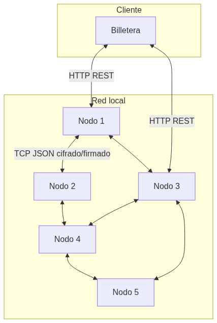

# Arquitectura de la aplicación

Descripción de nodos, conectividad y mecanismos de IPC. Los diagramas (clase, entidad, flujo, secuencia) se elaboran a partir de este documento y de **funcionalidades.md**.

---

## Vista de componentes

```
        ┌──────────────────────────────────────────────────────────┐
        │                        RED LOCAL                           │
        │   TCP: payload cifrado (clave precompartida) + firma       │
        │                                                            │
        │     ┌──────┐───────────────────────────────┌──────┐       │
        │     │Nodo 1│                                │Nodo 2│       │
        │     └──┬───┘                                └──┬───┘       │
        │        │                                       │           │
        │     ┌──┴───┐────────────┌──────┐────────────┌──┴───┐      │
        │     │Nodo 3│────────────│Nodo 5│────────────│Nodo 4│      │
        │     └──┬───┘            └──────┘            └──────┘       │
        │        │                                                   │
        └────────┼───────────────────────────────────────────────-─┘
                 │  HTTP (REST)
        ┌────────▼───────────────────────────────────┐
        │              Billetera (cliente)            │
        │  - Consola                                  │
        │  - Generador de transacciones de prueba     │
        └─────────────────────────────────────────────┘
```

Aristas TCP (idénticas al diagrama Mermaid): N1–N2, N1–N3, N2–N4, N3–N4, N3–N5, N4–N5.
La billetera habla HTTP con N1 y N3.

- **Nodos (4–5 en Docker)**: Cada uno tiene IP/puerto propio. Se conocen por **lista estática de peers** (argparse). Opcional a futuro: descubrimiento automático de peers.
- **Billetera**: Un proceso/cliente que se conecta por HTTP al nodo (o nodos) indicado por parámetro.



---

## Conectividad

| Origen       | Destino   | Protocolo | Uso |
|-------------|-----------|------------|-----|
| Nodo ↔ Nodo | Peer      | TCP        | Sobres JSON con payload cifrado (clave precompartida) y firma del emisor: handshake (HELLO), propagación de transacciones y bloques, solicitud/envío de cadena y mempool. |
| Billetera   | Nodo      | HTTP       | Consultas (balance, transacciones, estado) y envío de transacciones (POST). |
| Nodo        | SQLite    | Archivo local | Persistencia de blockchain y mempool (cada bloque/tx aceptado). |

Cada nodo abre:
- **Un socket TCP** en un puerto (8001, 8002, …) para el protocolo entre nodos.
- **Un servidor HTTP** en otro puerto (9081, 9082, …) para la billetera y otros clientes.

La lista de peers se pasa por línea de comando (`--peers 127.0.0.1:8002,127.0.0.1:8003`). **Estrategia de conexión**: cada nodo mantiene una **conexión TCP persistente** con cada peer de su lista. Si una conexión se cae, el nodo espera un **delay fijo** (`--reconnect-delay-seconds`) y vuelve a conectar hasta restablecerla (sin keepalive PING/PONG).

---

## Interior de un nodo (procesos e IPC)

Dentro de un mismo nodo conviven:

1. **Proceso principal (asyncio)**  
   - Event loop que: acepta conexiones TCP (otros nodos), acepta peticiones HTTP, lee/escribe mensajes.  
   - No bloquea en cálculos pesados: delega el PoW y otras tareas costosas.

2. **PoW (minado)**  
   - **ProcessPoolExecutor** y **run_in_executor**: el proceso principal envía “minar este bloque” al pool y recibe el resultado (nonce, hash) de forma asincrónica.

3. **Verificación de cadena y tareas pesadas (threading)**  
   - Para tareas como **verificación de cadenas** se usan **queue.Queue** y **workers** en hilos (`threading`). El proceso principal encola tareas; los workers las procesan y devuelven resultados por otra cola; el resultado se integra en el flujo asyncio vía un thread que notifica al loop.

4. **Sincronización**  
   - Acceso a **mempool** y **blockchain** en memoria protegido con locks (o estructuras thread-safe) cuando varias tareas asyncio o puntos de entrada (TCP/HTTP) los modifican o leen.

5. **SQLite**  
   - Escritura al vuelo al aceptar cada bloque y cada transacción relevante; lectura al arrancar para reconstruir estado.

Resumen de mecanismos IPC en el nodo:

| Mecanismo              | Uso en el nodo |
|------------------------|----------------|
| ProcessPoolExecutor    | PoW (minado) en paralelo. |
| queue.Queue + threading | Cola de tareas para workers en hilos (verificación de cadena). |
| Locks / thread-safe    | Mempool y blockchain en memoria. |
| asyncio                | Conexiones TCP y HTTP concurrentes. |

---

## Despliegue (Docker Compose)

- **Servicios**: 4–5 contenedores de nodo + 1 contenedor de billetera.
- **Nodos**: Misma imagen, distinta configuración por contenedor (puertos, `--peers`, `--difficulty`, número de workers / núcleos asignados). Se pueden limitar núcleos con `cpuset-cpus` o similar para simular nodos con distinta capacidad.
- **Billetera**: Cliente que apunta a uno o más nodos por URL (puerto HTTP).
- **Red**: Una red Docker común para que los nodos se vean por nombre de servicio o por IP asignada.
